<picture>
  <source media="(max-width: 640px)" srcset="./assets/hero-mobile.svg" />
  
</picture>

  <a href="#things-im-building"><b>Explore my work</b></a> &nbsp; · &nbsp;
  <a href="https://github.com/raghavkumartazi-source?tab=repositories"><b>All repositories</b></a> &nbsp; · &nbsp;
  <a href="https://github.com/raghavkumartazi-source/raghavkumartazi-source/issues/new"><b>Start a conversation ↗</b></a>

I'm **Raghav**, an ECE undergraduate at **IIT (BHU), Varanasi**. I like understanding how things work, then building something useful with what I learn. Here you'll find learning tools, browser extensions, and small fixes for everyday student life.

### Things I'm building

<a href="https://github.com/raghavkumartazi-source/universal-learning-gps">
  <picture>
    <source media="(max-width: 640px)" srcset="./assets/project-1-mobile.svg" />
    
  </picture>
</a>

<a href="https://github.com/raghavkumartazi-source/youtube-focus-mode">
  <picture>
    <source media="(max-width: 640px)" srcset="./assets/project-2-mobile.svg" />
    
  </picture>
</a>

<a href="https://github.com/raghavkumartazi-source/Semester-3-Attendance-Tracker">
  <picture>
    <source media="(max-width: 640px)" srcset="./assets/project-3-mobile.svg" />
    
  </picture>
</a>

### Currently in my orbit

**Building with** &nbsp; Next.js · React · TypeScript · JavaScript  
**Studying** &nbsp; Electronics & communication engineering  
**Drawn to** &nbsp; Useful software, better ways to learn, and ideas that become real projects.

<b>A little progress, every day ↗</b>

 
<picture>
  <source media="(max-width: 640px)" srcset="./assets/activity-mobile.svg" />
  
</picture>

Refreshed daily from public GitHub data. Language shares measure code bytes, not proficiency. Contribution totals follow GitHub's public calendar, which may include anonymous private activity if enabled.

---

<b>Stay curious. Make something useful. Repeat.</b> Made of questions, experiments, and a few late-night commits.

